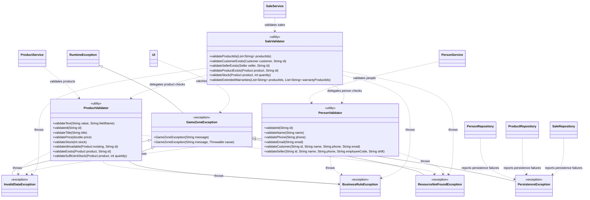

# Exception Handling — Class Diagram

The diagram shows the custom exception hierarchy, the validator classes, and their main relationships with the services, repositories, and console user interface.

## Key Design Notes

- `GameZoneException` provides a shared base type for application-specific errors.
- The specialized exceptions distinguish invalid input, business rule violations, missing resources, and persistence failures.
- The validator classes centralize checks and are used by the corresponding services.
- `SaleValidator` delegates shared product and person validations instead of duplicating them.
- The repositories report relevant data access failures through `PersistenceException`.
- The console UI catches `GameZoneException` and displays Spanish error messages.
